<div align="center">

# ⚽ Beyond the Ratings
### EA Sports FC — Football Analytics & Player Intelligence Dashboard

**An end-to-end Power BI project exploring player ratings, potential, team strength, coaches, playing styles, and position suitability across FIFA editions.**

   

**[📊 Dashboard screenshots](#-dashboard-walkthrough) · [🔎 Key findings](#-key-findings) · [🧱 Data model](#-data-model) · [📄 Documentation](#-project-files--documentation)**

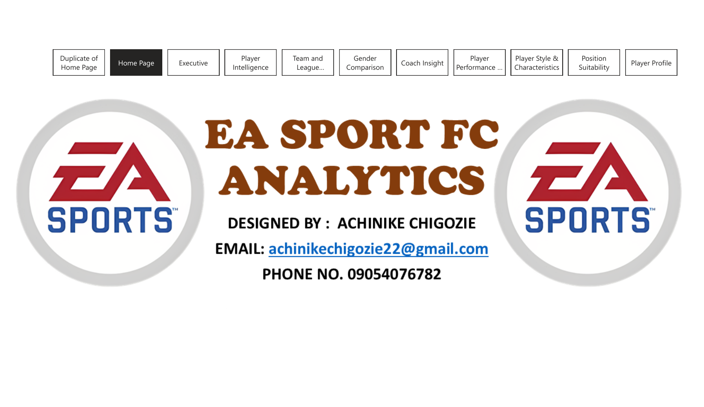

</div>

---

## 📌 Table of Contents

1. [Project Overview](#-project-overview)
2. [The Question Behind the Project](#-the-question-behind-the-project)
3. [Project Objectives](#-project-objectives)
4. [Tools and Skills](#-tools-and-skills)
5. [Dataset and Scope](#-dataset-and-scope)
6. [Data Preparation and Transformation](#-data-preparation-and-transformation)
7. [Data Model](#-data-model)
8. [KPIs and Measures](#-kpis-and-measures)
9. [Dashboard Walkthrough](#-dashboard-walkthrough)
10. [Key Findings](#-key-findings)
11. [Recommendations](#-recommendations)
12. [Limitations](#-limitations--interpretation-notes)
13. [Future Enhancements](#-future-enhancements)
14. [Project Files and Documentation](#-project-files--documentation)
15. [How to Explore](#-how-to-explore-the-project)
16. [What I Learned](#-what-i-learned)

---

## 🎯 Project Overview

When people compare footballers in EA Sports FC, the first number they often look at is **overall rating**. But does that number really tell us everything about a player?

I built this Power BI project to explore the details behind those ratings. I wanted to see how players differ by position, potential, attributes, preferred foot, and playing style—and how teams and coaches fit into the bigger picture.

The project brings together **six source datasets** covering male and female players, teams, and coaches. The report contains a **home page and nine analytical pages**, with interactive filtering and a player-profile drillthrough.

> **The central idea:** A player's overall rating is useful, but their attributes and positional suitability tell a much richer story.

### At a glance

| Dashboard indicator | Displayed value |
|:--|--:|
| Player count KPI | ~56K |
| Average overall player rating | 66 |
| Highest overall player rating | 94 |
| Average player potential | 71 |
| Highest player potential | 95 |
| Average team overall rating | 69 |
| Average coach age | 53 |
| Average position suitability rating | 53.4 |

*These are values shown on the supplied dashboard pages under their displayed filter selections. Player count may represent player-edition records rather than unique people; the measure definition should be checked in the PBIX.*

## ❓ The Question Behind the Project

Imagine two players with the same overall rating. One may be quicker, while the other is better at passing. They may also be suited to completely different positions. A single number does not explain those differences.

The raw data was spread across several datasets and FIFA editions, making it difficult to compare players and teams in a consistent way. I needed a reporting model that could connect the information and make it easy to explore.

**Questions I set out to answer:**

- Which playing positions appear most often in the dataset?
- How does overall rating compare with player potential?
- Which teams and leagues have higher ratings in the available game data?
- What can the available male and female records tell us—and what can they *not* tell us?
- What do pace, shooting, passing, dribbling, and playing-style fields reveal?
- How does a player's suitability change across positions?

## 🛠️ Project Objectives

- Combine the related player, team, and coach datasets into a consistent analytical structure.
- Build relationships that support filtering across players, teams, editions, and other dimensions.
- Develop interactive KPI cards, comparisons, and drillthrough pages in Power BI.
- Use real dashboard values to explain patterns in ratings, attributes, and position suitability.
- Document important data limitations instead of overstating what game ratings prove.

## 🧰 Tools and Skills

| Tool / skill | How it was used |
|:--|:--|
| **Power BI Desktop** | Interactive dashboards, slicers, visuals, navigation, drillthrough |
| **Power Query (M)** | Combining datasets, preparing fields, reshaping position ratings |
| **DAX** | KPI calculations and filter-responsive measures |
| **Data modeling** | Fact/dimension tables, keys, relationships, filter paths |
| **Data storytelling** | Turning numbers into understandable findings and limitations |
| **GitHub** | Sharing project evidence and documentation |

## 🗂️ Dataset and Scope

The project started with six datasets:

| Source dataset | Main content |
|:--|:--|
| Male players | Ratings, potential, clubs, positions, attributes, values |
| Female players | Ratings, potential, clubs, positions, attributes, values |
| Male teams | Team and league information, team strength ratings |
| Female teams | Team and league information, team strength ratings |
| Male coaches | Coach identity and descriptive fields |
| Female coaches | Coach identity and descriptive fields |

**Important fields:** `player_id`, `fifa_version`, `Gender`, `overall`, `potential`, `preferred_foot`, `player_positions`, `pace`, `shooting`, `passing`, `dribbling`, `value_eur`, and position suitability fields such as `gk`, `cb`, `cm`, and `st`.

**Source:** [ADD THE ORIGINAL DATASET NAME AND URL].  
**Edition coverage:** [ADD THE EARLIEST AND LATEST FIFA EDITIONS AFTER CHECKING THE SOURCE FILES].

**Unit of analysis:** A footballer can appear in multiple editions. Counts, averages, and monetary totals should therefore be interpreted with attention to the player-edition grain.

## 🔄 Data Preparation and Transformation

I prepared the data in Power Query before building the report. The overall workflow was:

```text
Six source datasets
        │
        ▼
Combine related male and female data
        │
        ▼
Check types, missing values, and identifiers
        │
        ▼
Prepare edition-aware player/team keys
        │
        ▼
Reshape position-rating columns into rows
        │
        ▼
Build the analytical model
        │
        ▼
Create DAX measures and dashboard pages
```

### The position suitability transformation

One of the most useful transformations was changing position ratings from **many separate columns** into a **position-and-rating structure**. Instead of having one column for each role, the resulting table can be analyzed by position name and rating. This supports comparisons across playing roles and the Player Profile drillthrough.

> **Reproducibility note:** The source PDF shows the completed report, not the Power Query Applied Steps. Add verified transformation screenshots or exported M scripts to this repository when available. Do not treat the workflow diagram above as an exact log of every applied step.

## 🧱 Data Model

The actual Power BI Model View is shown below.

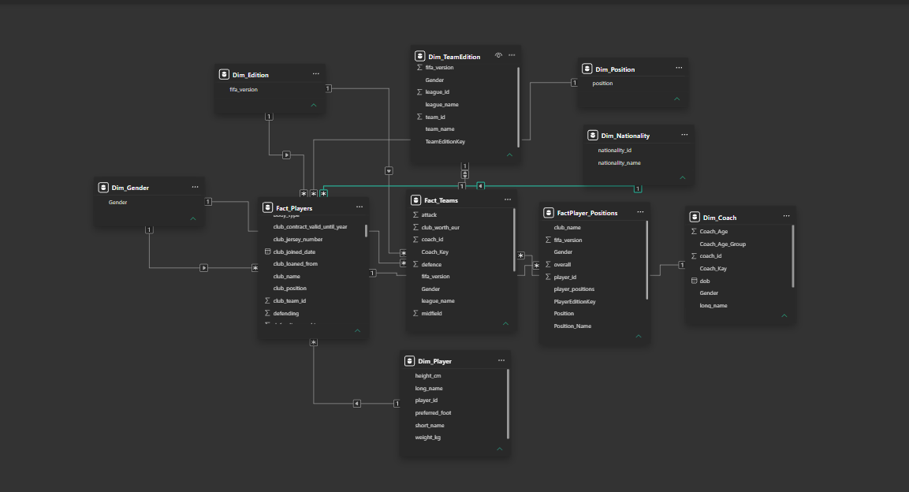

The model uses these tables:

| Fact tables | Dimension tables |
|:--|:--|
| `Fact_Players` | `Dim_Player` |
| `Fact_Teams` | `Dim_TeamEdition` |
| `FactPlayer_Positions` | `Dim_Edition` |
| | `Dim_Gender` |
| | `Dim_Position` |
| | `Dim_Nationality` |
| | `Dim_Coach` |

This structure helps separate numerical player/team/position records from descriptive fields used for filtering. Edition-aware keys are especially important because a player or team can have different values across FIFA editions.

**Before reproducing the model:** Confirm the exact join columns, relationship cardinalities, active relationships, and cross-filter directions in the `.pbix` file. The image documents the model layout but does not fully establish every relationship setting.

## 🧮 KPIs and Measures

The dashboard includes measures for player counts, average ratings, potential, team strength, coaches, attribute averages, and position suitability.

The following are **illustrative DAX patterns**, not verified exports from the completed report:

```dax
-- Example: average overall rating
Average Player Rating =
AVERAGE ( Fact_Players[overall] )

-- Example: highest potential
Highest Player Potential =
MAX ( Fact_Players[potential] )
```

**To make this repository fully reproducible:** Replace these examples with your final DAX formulas and publish them in a `dax/` folder. In particular, document the measure behind the ~56K count and any monetary totals across editions.

## 📊 Dashboard Walkthrough

### 1. Executive Overview — the big picture

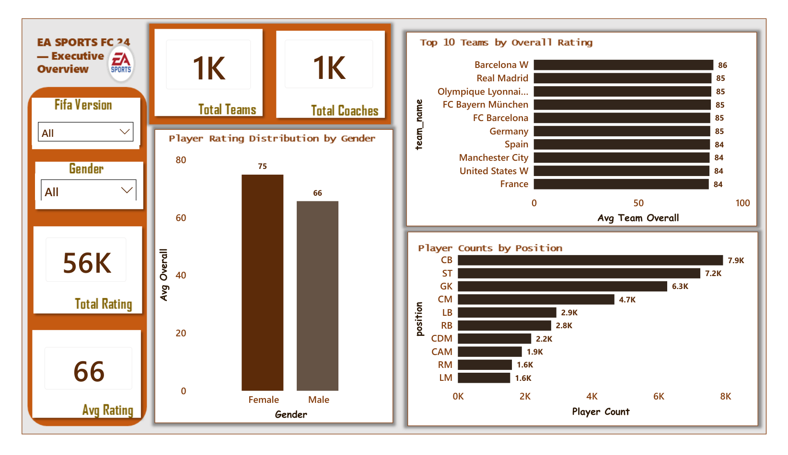

The opening analytical page brings together the headline player, team, and coach metrics. It also shows the distribution of players across positions and a ranking of highly rated teams.

**What stood out:** Centre-backs (~7.9K), strikers (~7.2K), and goalkeepers (~6.3K) are the largest displayed position groups.

### 2. Player Intelligence — current rating vs potential

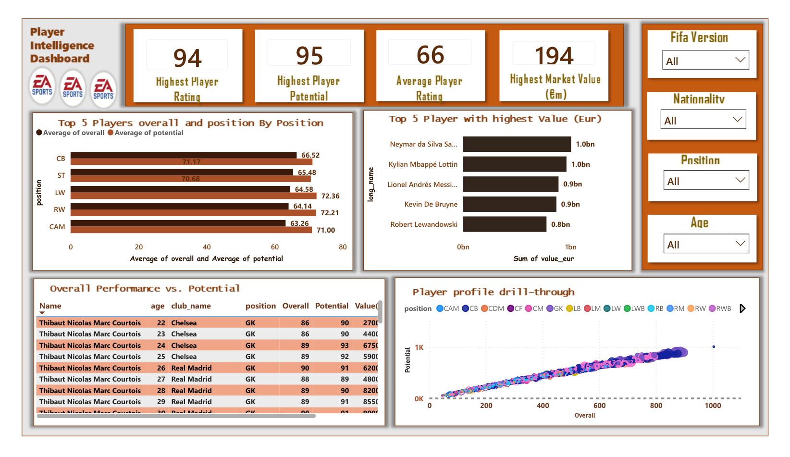

This page explores overall ratings, potential, player values, and individual comparisons.

**What stood out:** Average overall rating is **66**, compared with average potential of **71**—a gap of **5 rating points**. The highest overall rating shown is **94**, and highest potential is **95**.

**Caution:** Summing player market values across different editions does not produce a single-edition market value.

### 3. Team & League Intelligence — what makes a strong team?

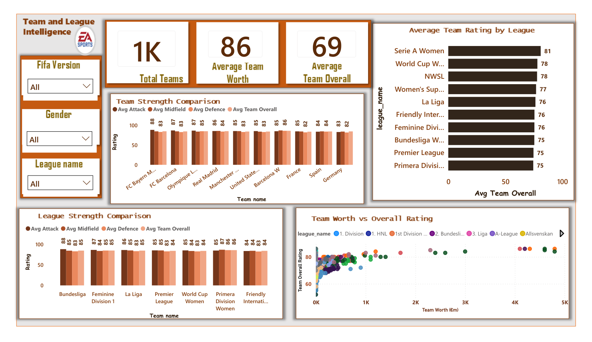

This page compares team ratings and attacking, midfield, and defensive strength.

**What stood out:** The dashboard's team ranking shows **Barcelona W at 86**, with several other leading teams at **85**. Looking at attack, midfield, and defense adds context that an overall team rating cannot provide on its own.

### 4. Gender Comparison — compare with care

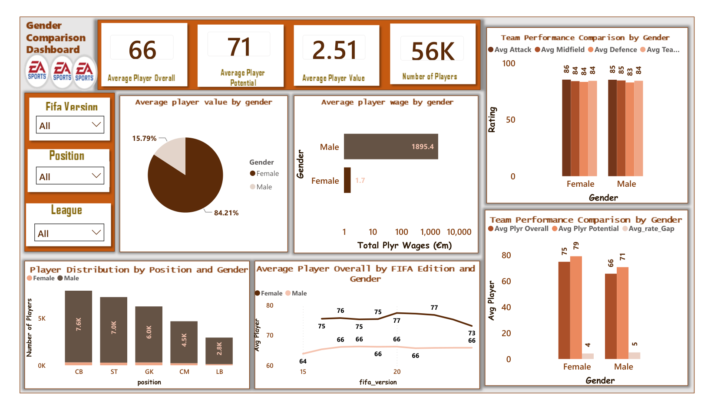

This page compares ratings and other available fields across male and female records and editions.

**What stood out:** The coverage of player records and financial fields is not identical across groups and editions. This limits direct comparisons of wages and values. The **84.21% / 15.79%** chart is **not labeled here as a player-count split** because its underlying aggregation needs verification.

### 5. Coach Insight — beyond the players

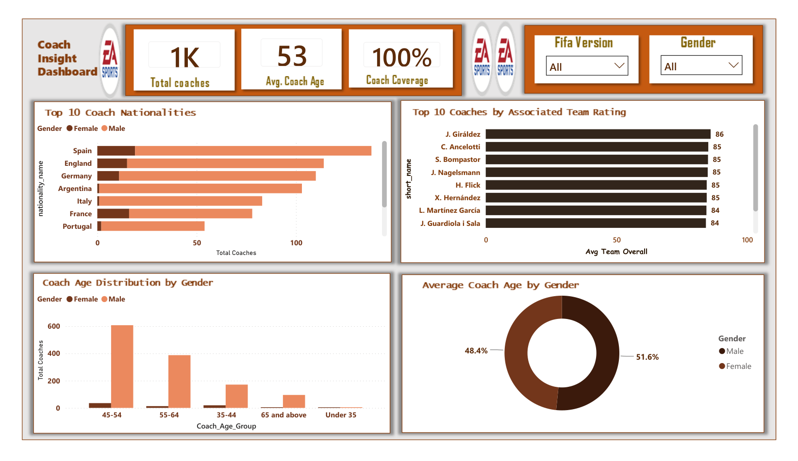

This page explores coach ages, nationalities, and team-related information.

**What stood out:** The displayed average coach age is **53**. These figures describe the available game records, not the worldwide coaching profession.

### 6. Player Performance & Attributes — skills behind the rating

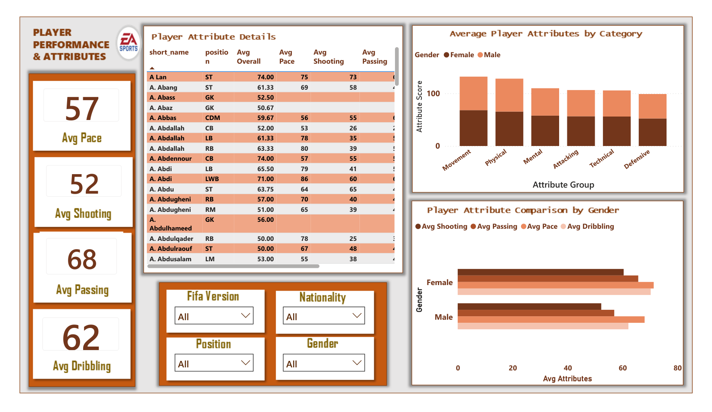

This page goes beyond overall rating to examine player attributes and attribute groups.

**What stood out:** The displayed averages include **passing 68**, **dribbling 62**, **pace 57**, and **shooting 52**. Different attributes may have different counts of non-missing records, so comparisons require care.

### 7. Playing Style & Characteristics — preferred foot and skill moves

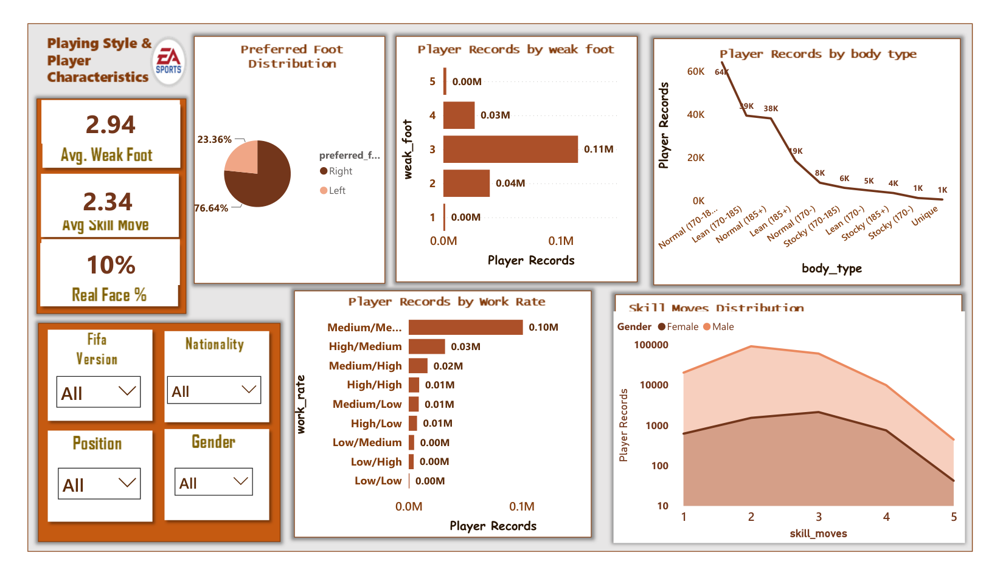

This page explores preferred foot, weak foot, skill moves, work rate, and body type.

**What stood out:** **76.64%** of the displayed records are right-footed, compared with **23.36%** left-footed. The displayed averages are **2.94** for weak foot and **2.34** for skill moves.

### 8. Position Suitability — is a great player great everywhere?

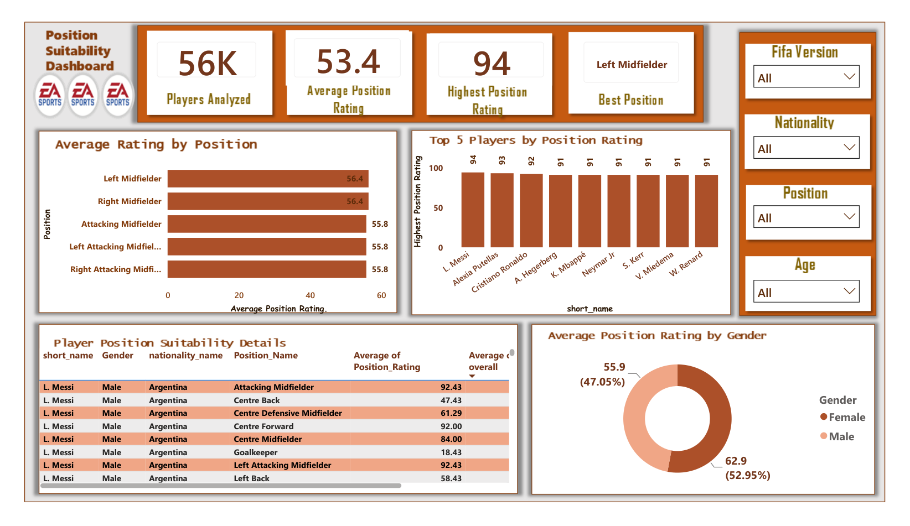

This page compares position-specific ratings across the available player records.

**What stood out:** The average position rating is **53.4** and the highest is **94**. Left and right midfield both appear at **56.4** in the displayed averages. This is a comparison of suitability ratings, **not** proof that one playing position is better than another.

### 9. Player Profile — the strongest example

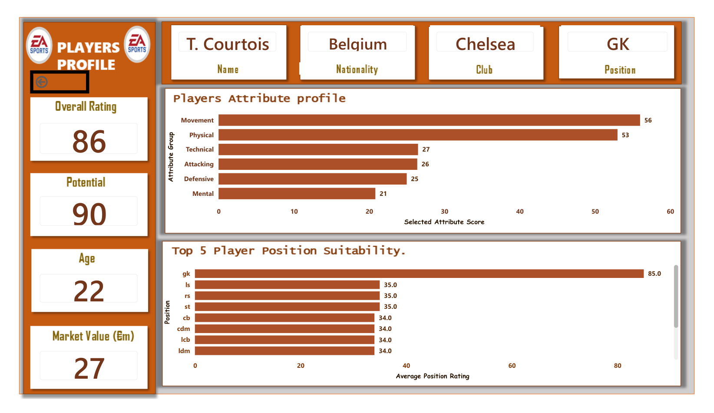

The drillthrough page lets the user focus on a particular player's profile and position suitability.

**The example that brought the project together:** A historical **Thibaut Courtois** profile shows an **overall rating of 86**, **potential of 90**, and a **goalkeeper suitability rating of 85**. His **centre-back suitability rating is 34**—a **51-point difference** for the same player.

That is the clearest illustration of this project's central idea: **a single overall rating cannot tell us how suitable a player is for every role.**

## 🔎 Key Findings

| Finding | Dashboard evidence | Why it matters |
|:--|:--|:--|
| Position groups are uneven | CB 7.9K; ST 7.2K; GK 6.3K | Position mix affects overall comparisons |
| Potential exceeds current rating on average | 71 vs 66 | Current rating and potential answer different questions |
| Top team ratings are close | Barcelona W 86; several teams 85 | Team attributes add detail beyond overall strength |
| Right foot is more common | 76.64% vs 23.36% | Playing-style characteristics are unevenly distributed |
| Individual attributes differ | Passing 68; shooting 52 | An overall score hides skill differences |
| Position matters enormously for an individual | Courtois GK 85 vs CB 34 | The same player can have very different role suitability |

## 💡 Recommendations

1. **Compare like with like.** Evaluate strikers against strikers and defenders against defenders using attributes relevant to their roles.
2. **Keep edition filters visible.** Use a single FIFA edition when comparing individual market values, wages, or player rankings at a point in time.
3. **Pair overall rating with attributes.** Show pace, shooting, passing, dribbling, and position suitability alongside overall scores.
4. **Check data coverage before gender comparisons.** Report missing values and sample sizes, especially for financial fields.
5. **Make measure definitions transparent.** Document whether a count represents unique players, player-edition records, or another unit.
6. **Use drillthrough to explain the averages.** Individual profiles make the meaning of the position-suitability analysis easier to understand.

## ⚠️ Limitations & Interpretation Notes

- **Game data, not match tracking:** EA Sports ratings are game assessments and should not be treated as direct measurements of real-world football performance.
- **Multiple editions:** A player can appear more than once. Summed values across editions may be misleading when presented as one player's value.
- **Missing values:** Some fields are not equally complete across positions, genders, and editions.
- **Dashboard filter context:** Values shown on different pages may not use identical selections or denominators.
- **Verification still needed:** The exact count definition, financial aggregations, some gender visuals, and the final DAX formulas should be confirmed in the source `.pbix`.

## 🚀 Future Enhancements

- Add edition-by-edition player development charts and comparisons.
- Create position-specific player comparison pages.
- Include a data-quality page with missing-value counts and field coverage.
- Add a measure dictionary containing final DAX definitions and aggregation rules.
- Export Power Query transformations and relationship metadata for reproducibility.
- Improve financial charts so they compare values within the same edition.

## 📁 Project Files & Documentation

```text
EA-Sports-FC-Analytics-PowerBI/
├── README.md
├── assets/
│   ├── dashboard/
│   │   ├── page_1.png             # Home page
│   │   ├── page_2.png             # Executive Overview
│   │   ├── page_3.png             # Player Intelligence
│   │   ├── page_4.png             # Team & League Intelligence
│   │   ├── page_5.png             # Gender Comparison
│   │   ├── page_6.png             # Coach Insight
│   │   ├── page_7.png             # Player Performance & Attributes
│   │   ├── page_8.png             # Playing Style & Characteristics
│   │   ├── page_9.png             # Position Suitability
│   │   └── page_10.png            # Player Profile
│   └── model/
│       └── data-model.png
└── docs/
    ├── Project_Documentation.docx
    └── Project_Presentation.pptx
```

**Project documentation:** [Open the Word report](docs/Project_Documentation.docx)  
**Presentation:** [Open the PowerPoint](docs/Project_Presentation.pptx)  
**Power BI report (.pbix):** Not included yet — add your completed report before publishing if you want others to explore it.  
**Interactive dashboard:** Add your Power BI Service URL when published.  
**Project walkthrough video:** Add your video URL after recording.  
**Dataset source:** Add the original dataset citation and URL before publishing.

## ⚙️ How to Explore the Project

1. Browse the screenshots in the [dashboard walkthrough](#-dashboard-walkthrough).
2. Review the [Power BI data model](#-data-model) and the [project documentation](docs/Project_Documentation.docx).
3. If the `.pbix` is added, download it and open it in **Power BI Desktop**.
4. Use the report slicers to filter by available categories such as gender, edition, and team.
5. Explore the Player Profile drillthrough to examine an individual player.
6. If source datasets are not included, the report may need its original file paths or data source settings updated before refresh.

### System requirements

- Windows with a compatible version of **Microsoft Power BI Desktop** to open the `.pbix` file.
- Access to the original source files or configured data source if refreshing is required.
- A GitHub account only if you want to fork or contribute to the repository.

## 🎓 What I Learned

This project helped me practice Power Query transformations, relational data modeling, DAX, dashboard design, and analytical storytelling. The biggest lesson was not just technical: **a chart can be attractive and still be misleading if the underlying measure or comparison is not clear**.

I started by asking who had the highest rating. I finished by asking what the rating actually measures—and what other information we need to understand the player.

## 🏁 Conclusion

The dashboard shows that football data becomes more useful when we look beyond overall ratings. Player potential, technical attributes, preferred foot, team strength, and position suitability each add a different piece of the picture.

For me, the historical Courtois profile says it best: **85 as a goalkeeper, 34 as a centre-back**. Same player, very different role suitability.

> **Good analysis is not only about finding the biggest number. It is about understanding what the number means.**

---

<div align="center">

**Built with Power BI, Power Query, and DAX.**  
*If this project was useful, feel free to star the repository.* ⭐

**Author:** Add your name · **GitHub:** Add your profile URL · **LinkedIn:** Add your profile URL

</div>
